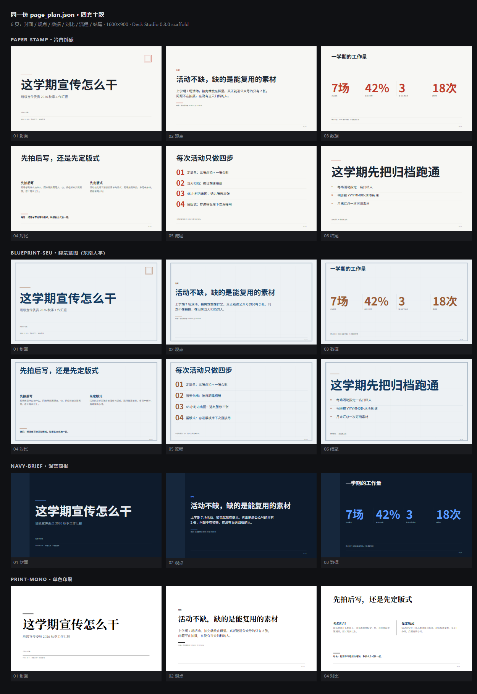

# Deck Studio

把「写内容 → 出草稿页 → 改字换图 → 交付可编辑 PPTX」收成一条链路的 DeepSeek Harness 插件。

A host-only DeepSeek Harness plugin that turns a page contract into themed SVG slides and an editable PPTX.



---

## 它解决什么

做 PPT 的真问题通常不是「画不出好看的页面」，而是后面这四件事：

1. **每页从零排**——没有骨架，页与页之间没有共同的语言，改一页又破另一页。
2. **文案和版面打架**——标题超了 6 个字只能缩字号，缩到投影看不清。
3. **改一个字要开设计工具**——交给同学改文案，等于把源文件交出去。
4. **交付不可用**——导出的 PPTX 是一堆图片，或者中文字体在别人电脑上变成宋体。

Deck Studio 的答案是：**先定页面契约，再由契约生成版面**。文案有槽位和字数上限，版式由主题决定，导出是可编辑的原生文本框。

## 四件事

| 能力 | 说明 |
| --- | --- |
| **页面契约** | 项目根目录写 `page_plan.json`：一页一条，声明原型 + 槽位文案。`brief` 给预算，`check` 逐槽核字数，超限直接拦导出 |
| **骨架 + 主题** | `scaffold` 按契约把 10 个原型画成 SVG，每个原型 2 个变体（`impact` 强主张 / `density` 信息密），7 套主题换一套就是另一种版面语言 |
| **浏览器改字** | `edit` 生成一个单文件 HTML 编辑器，Chrome/Edge 打开、选一次项目目录，改完直接写回 `page_plan.json` 与 `svg_output/`，不需要起服务 |
| **可编辑交付** | `export` 出原生文本框的 PPTX（中文自动换 TTF 家族），`mixed=true` 在保真失败时栅格化背景，`native_plan.json` 能把学院官方模板的原生封面/目录/3D/视频页拼进来 |

## 安装

```text
plugin_manager(action="install_bundle", target="git+https://github.com/0-OsealO-0/dsh-deck-studio")
```

装完重启 DSH，新会话里出现 `deck` 工具与 `deck-studio` skill。完整步骤、配置项、排错见 [INSTALL.md](INSTALL.md)。

## 依赖

| | 需要什么 | 用途 |
| --- | --- | --- |
| 必需 | Python 3.10+，且 `python-pptx` 可导入 | 渲染与导出 |
| 必需 | Node.js 18+（DSH 自带运行时即可） | 插件本体 |
| 可选 | Microsoft PowerPoint 桌面版 | PDF / PNG、原生页拼接 |
| 可选 | Playwright + Chromium | `check(review=true)` 视觉回渲 |
| 可选 | Chrome 或 Edge | `mixed=true` 混合导出、编辑器保存 |
| 建议 | 思源黑体 / 思源宋体 TTF | 跨机器一致的正式交付 |

Python 按 `DSH_DECK_PYTHON` → `DSH_PYTHON` → `PYTHON` → DSH 运行时 → 常规安装 → PATH 的顺序探测，并优先选能 `import pptx` 的那个。浏览器和 PowerPoint 也可用 `DECK_BROWSER` / `DECK_POWERPOINT` 指定。

## 五分钟上手

```text
deck(action="propose", project="C:\\work\\demo", profile="formal", title="月报", brief="三分钟讲清本月三件事")
# 用户从三个方向里挑一个
deck(action="init", project="C:\\work\\demo", profile="formal", title="月报", brief="…", option="navy-brief")
deck(action="brief", project="C:\\work\\demo")          # 拿槽位预算
# 按预算写 page_plan.json
deck(action="scaffold", project="C:\\work\\demo", theme="blueprint-seu")
deck(action="check", project="C:\\work\\demo")
deck(action="export", project="C:\\work\\demo", format="all")
```

`project` 必须是绝对路径——插件工具没有 cwd。

`page_plan.json` 长这样：

```json
{
  "version": 1,
  "profile": "formal",
  "theme": "blueprint-seu",
  "pages": [
    { "file": "01_cover.svg", "archetype": "cover", "variant": "impact",
      "text": { "title": "这学期宣传做了什么", "subtitle": "2026 秋季学期 · 10-26 → 11-24", "meta": "东南大学 · 班级宣传委员" } },
    { "file": "02_metrics.svg", "archetype": "metrics", "variant": "impact",
      "text": { "headline": "这一学期的产出", "metrics": ["22 项成品", "4 场活动", "18 版展板"] } }
  ]
}
```

## 十个动作

| 动作 | 作用 | 主要产出 |
| --- | --- | --- |
| `propose` | 出三个候选视觉方向 | `confirm_ui/direction_options.json` |
| `init` | 建项目骨架 | `source.md` / `design_spec.md` / `spec_lock.md` / `svg_output/` |
| `status` | 看还缺什么、探测到了哪个 Python | — |
| `brief` | 给页面契约的槽位预算，逐页报占用 | 终端文本 |
| `scaffold` | 按契约生成 SVG 草稿页 | `svg_output/*.svg` |
| `edit` | 生成单文件浏览器编辑器 | `exports/<标题>-edits.html` |
| `check` | 质量门 + 字号/图片/字体自查 + 字数审计 | `validation/svg_quality_report.json` |
| `export` | SVG → PPTX（可选 PDF/PNG/混合/原生页） | `exports/*.pptx` |
| `html` | 内联成单文件键盘导航演示 | `exports/*.html` |
| `animate` | DryRun 提案，确认后写动画 | `animations.json` |

## 十个页面原型

| 原型 | 一句话 | 典型页 |
| --- | --- | --- |
| `cover` | 封面：一句主标题 + 时间地点 | 第 1 页 |
| `statement` | 观点页：一句主张 + 一段支撑 | 判断、结论 |
| `notice` | 通知页：时间/地点/对象 + 勾选清单 + 联系人 | 群通知、班会 |
| `image` | 图文页：左文右图 | 作品、现场照片 |
| `hero` | 招新大图页：整页照片 + 时间地点 + 报名按钮 | 招新、活动宣传 |
| `metrics` | 数据页：3–4 个大数字 | 工作量、成绩 |
| `chart` | 柱状图页：3–6 根柱子 | 构成、对比 |
| `comparison` | 对比页：左右两栏 + 结论条 | 方案 A/B |
| `process` | 流程页：3–5 步 | 方法、步骤 |
| `closing` | 收尾页：一句主张 + 1–3 条行动 | 致谢、下一步 |

每个原型两个变体：`impact`（字号更大、留白更多）与 `density`（信息更密）。

## 七套主题

| id | 名字 | 场景 | 底色 |
| --- | --- | --- | --- |
| `paper-stamp` | 纸感印章 · 冷白 | 正式汇报 | `#F7F7F4` |
| `navy-brief` | 深蓝简报 | 正式汇报 | `#0E1B2C` |
| `blueprint-seu` | 建筑蓝图 · 东南大学 | 学术汇报 | `#EDF1F4` |
| `neon-cyan` | 霓虹青 · 活动暗厅 | 活动宣传 | `#0A0B0F` |
| `warm-sand` | 暖沙 · 活动浅底 | 白天群发 | `#FFF6EC` |
| `print-mono` | 单色印刷 | 文艺、印刷 | `#FFFFFF` |
| `ink-water` | 水墨 · 宋体 | 文艺、投稿 | `#F4F1E9` |

主题是纯数据（一份约 40 行），新增一套不需要碰渲染器；检查清单见 [docs/theme-fonts.md](docs/theme-fonts.md)。

## 交付链

- **`check`**：SVG 契约（根 viewBox、`data-pptx-*` 标注、禁用元素）+ 字号是否登记 + 图片是否缺失/未登记版权 + 页面契约字数。失败时列前 5 条并给改法。
- **`export`**：走内置的 `ppt-master`（MIT，未修改）转 PPTX，再修中文字体；每页顶层是一个 group，里面才是原生文本框与形状，文字可选中可编辑。
- **`mixed=true`**：转换器保不住背景时（复杂渐变、滤镜、部分图片），把背景层栅格化、文字仍保留为原生文本框。代价是体积约 3.6×。
- **`native_plan.json`**：用学院官方模板替换封面/目录，或追加致谢页；`!!字段名` 占位符会被替换（文字或图片），3D 模型、宣传片这类原生对象随页面一起搬过来。

## 已知限制

- 骨架只管版面关系，**不替你判断内容值不值得讲**；需要内容红队时按 SKILL.md §2.4 写「主张/支撑/反问」。
- 编辑器只改文字与图片，不做拖拽排版；保存走 File System Access API，只支持 Chromium 系浏览器。
- `check(review=true)` 依赖 Playwright，缺了会如实报 `ok=false`，不会假装通过。
- 不承诺跨机器字体一致；正式交付优先 PDF，或把字体嵌进 PPTX。
- 预览与 PPTX 之间残留约 1px 的字宽差异（页码最明显）。

## 目录

```text
index.js                  Host 插件入口 + deck 工具 + skill provider
lib/page-contracts.mjs    页面契约：原型、槽位、字数与配图审计
lib/skeleton.mjs          原型渲染器：SVG 生成
lib/themes.mjs            7 套主题的 token 与字号阶梯
lib/editor.mjs            单文件浏览器编辑器
lib/paths.mjs             Python / 浏览器 / PowerPoint 自动探测
vendor/ppt-master/        内置的官方 ppt-master 脚本（MIT，未修改）
templates/                三套 spec_lock 模板
scripts/                  字体修复、PPTX 导出、原生页拼接、冒烟与 QA
skills/deck-studio/       工作流说明（SKILL.md）
docs/                     各阶段验收记录与对照图
INSTALL.md                双语安装、配置与排错
THIRD_PARTY.md            第三方组件与许可证
```

## 许可证

插件自身 MIT，见 [LICENSE](LICENSE)。内置的 `ppt-master` 同为 MIT，版权归 Hugo He，完整声明保留在 `vendor/ppt-master/LICENSE`。`vendor/ppt-master/scripts/svg_to_pptx/drawingml/elements.py` 有一处本地校准（首行基线 0.85em → 0.98em），原因与复测方法见 [docs/vendor-patches.md](docs/vendor-patches.md)。
