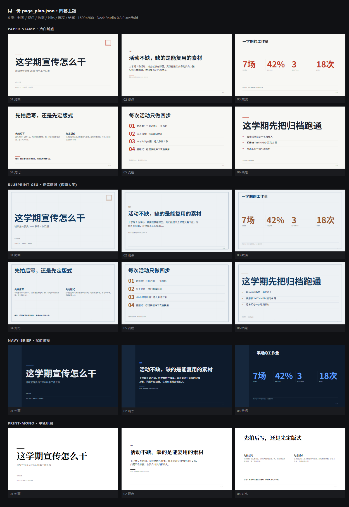

# 阶段 2 验收记录（v0.3.0：骨架 + 主题）

日期：2026-11-24 · 插件：`C:\Users\30139\Documents\deepseek-harness\dsh-deck-studio` · 动作：`deck(action="scaffold")`

## 这一阶段交付了什么

| 交付 | 位置 | 说明 |
| --- | --- | --- |
| 6 个页面原型 | `lib/page-contracts.mjs` | cover / statement / metrics / comparison / process / closing，沿用阶段 1 的槽位与字数上限 |
| 12 个骨架变体 | `lib/skeleton.mjs` | 每个原型 × `impact`（主张优先）/ `density`（信息优先） |
| 5 套视觉语言 | `lib/themes.mjs` | `paper-stamp` / `navy-brief` / `blueprint-seu` / `neon-cyan` / `print-mono` |
| `scaffold` 动作 | `index.js` | 按 `page_plan.json` 出 SVG 草稿；已有页面默认跳过；同步 `spec_lock.md` 字号阶梯；写 `validation/skeleton_report.json` |
| 字号阶梯登记 | `index.js#ensureLockRoles` | display 128 / title 76 / headline 54 / subtitle 34 / body 24 / meta 16 / caption 13 / pageNumber 11 / metric 120 / kicker 18 |

主题是一组数据（palette + 字号阶梯 + 网格 + 边框几何），不是一套组件：`typeSize()` 只查表，不做乘数——质量门会把「未登记字号的第 3 次使用」当成新角色，任何缩放都会凭空造角色。

## 三条验收口径

### 1. 同内容两份肉眼可辨 —— 通过

同一份 6 页 `page_plan.json`（封面「这学期宣传怎么干」、观点「活动不缺，缺的是能复用的素材」、数据「7 场 / 42% / 3 / 18 次」、对比「先拍后写 vs 先定版式」、流程「每次活动只做四步」、结尾「先把归档跑通」）分别用四套主题生成，**页面文案一字未改，版面语言全部不同**：

- `paper-stamp`：冷白纸感 + 朱红细规则 + 右上印章双框，标题 128 号黑体，行距紧。
- `blueprint-seu`：`#EDF1F4` 蓝图纸 + 160×120 疏网格（0.38 透明）+ 双线图签外框，标题墨蓝 `#12385F`，强调色赭石 `#9A5B33`。
- `navy-brief`：`#0E1B2C` 深底 + 左侧 200px 色带，标题白色，指标 `#5B9DFF`。
- `print-mono`：白底黑墨 + 宋体标题，无彩色强调，靠字重与留白分层。

### 2. 质量门不因骨架而放宽 —— 通过

四套主题各 6 页，`deck check` 结果：

| 主题 | ok | errors | warnings |
| --- | --- | --- | --- |
| paper-stamp | true | 0 | 6 |
| blueprint-seu | true | 0 | 6 |
| navy-brief | true | 0 | 6 |
| print-mono | true | 0 | 6 |

6 条警告全是同一类：`Source Han Sans SC TTF` 不是 PPT-safe 字体（与改动前样例一致，靠 `export` 的字体修复兜底）。

门禁在这一阶段真的拦下了三次实现问题，都改在渲染器里而不是关掉检查：

- 蓝图主题的装饰 `<g>` 没声明 `data-pptx-bounds`，6 条 ERROR：装饰层统一包进 `<g id="frame" data-pptx-bounds="0 0 1600 900">`。
- 组级 `opacity` 被转换器判为不可保真：网格线改成逐条 `opacity="0.38"`。
- 深底主题左侧色带是根级散元素，触发「ungrouped top-level element」：与装饰层合并成一个 frame 组，每页固定为背景 / 装饰 / 内容三个根模块。

### 3. 骨架页仍能导出可编辑 PPTX —— 通过

- `deck export` 4.4 秒，6 页，15240000×8572500 EMU（1200×675 pt）。
- 每页顶层 1 个 group，递归后文字与 SVG 一致（cover 4 段 / statement 6 段 / metrics 11 段 / comparison 9 段 / process 11 段 / closing 9 段），中文无乱码、无 OCR。
- 深浅两种主题（paper-stamp / navy-brief）各导一次，封面文字逐字相同。

### 4. 自动化 —— 41/41 通过

`node scripts/smoke-deck.mjs` 在 0.2.0 的 32 项之上新增 9 项（4b. scaffold 段）：无契约报错指回 `brief`、3 页生成且带 `deck-scaffold theme=…`、`spec_lock` 实际写成 `body: 24`、`data.themes` 含 `blueprint-seu`、二次运行跳过 3 页、未知主题报错列出可用主题、`renderPage` 同输入同输出、换主题后 `<tspan>` 数相同且文字仍在。

## 已知边界

- 骨架只画「文字槽位 + 装饰几何」，目前**不含图片位、图表、数据可视化**；要放图得手改 SVG（`<image href="images/…">` 并登记 `image_sources.json`）。
- 原型只覆盖 formal 的 6 类；campaign 的招新 / 活动页、literary 的长文页还没有专属原型（复用这 6 类，靠主题区分）。
- 换主题只换语言，不换信息结构；`density` 变体只是字号与行数档位，不是独立版式库。
- `page_plan.json` 里写了 `theme` 时它会盖过上次 `skeleton_report.json` 的记录；两处不一致时 `scaffold` 会在 message 里提示一句。
- 字体仍依赖本机安装的思源黑体 / 宋体；`print-mono` 的衬线标题在没装思源宋体的机器上会退回系统宋体（观感有差）。

## 下一步（阶段 3：浏览器编辑 v0.4.0）

验收口径：改 3 处字 ≤30 秒、保存后重渲染不破。骨架页的每个文字块已经有稳定的 role 与顺序，`data-field` 的落点就在 `lib/skeleton.mjs` 的 `block()` 输出上——阶段 1 的槽位 id 不会返工。
