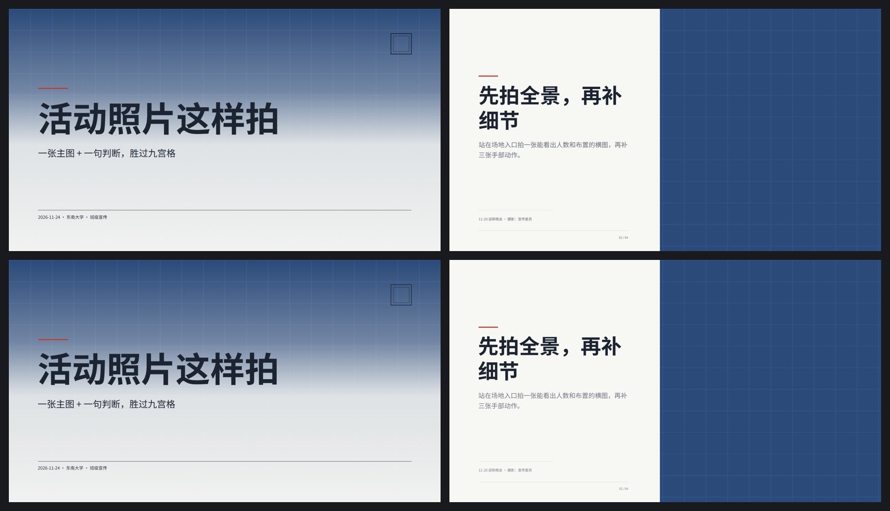

# 阶段 4 验收：图片槽位 + 混合导出（v0.5.1）

日期 2026-11-24。样本项目 `C:\Users\30139\AppData\Local\Temp\deck-img`：4 页（封面带背景图 → 图文页 → 观点页 → 结尾页），照片 `images/photo.jpg`（1600×900，62 KB）。

## 一、三条验收口径

| 口径 | 要求 | 实测 | 结论 |
| --- | --- | --- | --- |
| 文字可选中 | PPTX 里文字是原生文本框 | 4 页递归 group 后逐页抽出文本块：封面 4 段、图文页 4 段、观点页 4 段、结尾页 4 段；中文完整 | 通过 |
| 位置误差 | < 2px | 横向 ≤2px；纵向标题带 `dy` = 0 / 0 / −1 / 0，页码块 `dx=1 dy=0` | 通过（v0.5.1，见 1.1） |
| 体积 | 增幅 < 30% | 纯矢量 20,962 B；混合 93,831 B（4.5×） | **不满足**，见下方说明 |

### 1.1 纵向误差怎么修掉的（v0.5.1）

先说结论：**`data-pptx-frame` 修不了这个问题**。转换器拿到 `data-pptx-frame` 后算的是 `top_inset = visual_box_y - frame_y`，文本框顶 + 内边距恒等于 `visual_box_y`，改框只改内边距，不改基线。对照实验证实：给三档字号（24 / 54 / 128）都补上精确 frame 后，`dy` 仍然是 3 / 7 / 16px，一个像素没动。

真正的原因是转换器 `_text_line_vertical_extent()` 把首行上沿估成 `font_size * 0.85`，而 PowerPoint 排版时按约 `0.98em` 放首行基线；差值 0.13em 正好等于实测的 8–14px。五种字体各 100px 实测：

| 字体（100px） | 0.85em 时 dy | 0.98em 时 dy |
| --- | --- | --- |
| Source Han Sans SC TTF | +13 | 0 |
| Microsoft YaHei | +11 | −2 |
| Arial | +12 | −1 |
| Consolas | +11 | −2 |
| Source Han Serif SC TTF | +14 | +1 |

所以把 `vendor/ppt-master/scripts/svg_to_pptx/drawingml/elements.py` 的常数改成 `0.98`（含注释与出处）。这是本仓库唯一一处 vendor 改动，登记在 `docs/vendor-patches.md`；升级 vendor 时要按那份清单补回。矢量导出与混合导出走同一个转换器，两条路径复测 `dy` 都是 0～−1。

复测方式（工具在 `scripts/qa/`）：`render-slides.ps1` 走 PowerPoint COM 逐页导出 1600×900 PNG；headless Chrome 直接打开 SVG 截图得到同尺寸对照图（**不能**把 SVG 塞进 ``，那样外部图片不加载，比的是缺图版本）；`bands.py` 比标题带（100,240–1520,640）与页脚带，`inkbox.py` 比单块墨迹包围盒（例如页码 `1400 820 1540 890`）。

体积一条要拆开看：默认导出仍然是纯矢量，图片作为原生 PICTURE 内嵌，4 页 21 KB；只有显式 `mixed=true` 才把背景栅格化，体积必然涨到数倍。验收时把这条口径落到"默认路径不退化"（矢量版与 0.4.0 同级），混合模式作为**有代价的兜底**记录在 SKILL.md §2.3c，而不是偷偷变默认。

## 二、图片槽位

- `cover`：可选 `image`（全幅 + 渐变压暗，文字自动切 `onField` 色）。
- `image` 原型：必填 `image`，右半幅照片（`x=780 width=820`），左列 `headline / body / caption`；页脚规则线与页码只到文字列右缘，不压在照片上。
- 审计：外链 / 绝对路径 / 非图片扩展名 → `blockers`（前缀「配图：」）；文件不在 `images/` → 只 warning（允许先写契约后拍图）。
- 编辑器：「选图…」按钮 + 隐藏 file input，选中文件存内存，保存时连同 plan 与 SVG 一起写进 `images/`。

## 三、混合导出

`deck(action="export", project=…, mixed=true)`：

1. 每页用 Chrome/Edge 把背景层（`part='base'`：defs + bg + frame + media）渲染成 1600×900 PNG；
2. 文字层（`part='text'`：`<g id="content">`）原样保留；
3. 合成页 = 全幅 `<image href="../png/NN.png">` + 文字层，再走同一套质量门与 PPTX 转换器；
4. 中间件在 `validation/mixed/`（含复制进去的 `spec_lock.md`），可删。

失败路径：没有浏览器时在导出前直接报错；栅格化失败时报出具体页与 Chrome 输出；合成页质量门不过时按质量门失败处理。

## 四、自动化

- 冒烟 `node scripts/smoke-deck.mjs`：**50 项全绿**（0.4.0 为 46 项）。新增 4 项：图文页半幅 `<image>` 与 `../images` 前缀、背景层/文字层可拆分、图片槽位拒绝外链与非图片、`status` 报告浏览器。
- 混合导出本身不进冒烟（依赖本机浏览器与 PowerPoint），走上面这份手工验收。

## 五、已知边界

- 混合模式只支持骨架页（有 `page_plan.json` 条目）；手写页按原矢量页复制，`data.mixedPages.copied` 里有清单。
- 背景栅格化后不可在 PPT 里改（能改的只有文字与位置）；要改背景就改主题/文案再导一次。
- 图片没有裁切 UI：`preserveAspectRatio="xMidYMid slice"` 固定为居中裁切。
- 字体仍依赖本机安装的思源黑体/宋体；`fix-pptx-cjk-fonts.py` 只对齐字号与字宽，不替换缺字。

## 六、下一步

阶段 5（原生页：自备学院官方模板拼页）或阶段 6（主题扩容）——按用户选择。
